 

    <picture>
        <source media="(prefers-color-scheme: dark)" srcset="docs/assets/icons/logo-horizontal-dark.png">
        <source media="(prefers-color-scheme: light)" srcset="docs/assets/icons/logo-horizontal-light.png">
        
    </picture>

 

anm /anm/ n.

Primitive Irish · From Proto-Celtic anman, meaning "name"; ancestor of Old Irish ainmm and Modern Irish ainm.

---

**ainmax** is a JAX-powered Python library for numerical computing, built around named arrays and composable mathematical abstractions.

By combining explicit array semantics with JAX's compilation, automatic differentiation, and accelerator execution, ainmax provides a foundation for building expressive, efficient, and scalable scientific computations.

## Features

- **Named arrays** — Multidimensional arrays with explicit semantic axes, making complex tensor operations easier to express and reason about.
- **Numerical computing** — A collection of composable array operations, linear algebra, and scientific computing utilities.
- **Lie groups and algebras** — Mathematical abstractions for structured spaces and transformations.
- **JAX integration** — Automatic differentiation, compilation, vectorisation, and accelerator execution.
- **Scalable computation** — Foundations for distributed and multi-device numerical workloads.

## Installation

Requires Python 3.12 or later.
